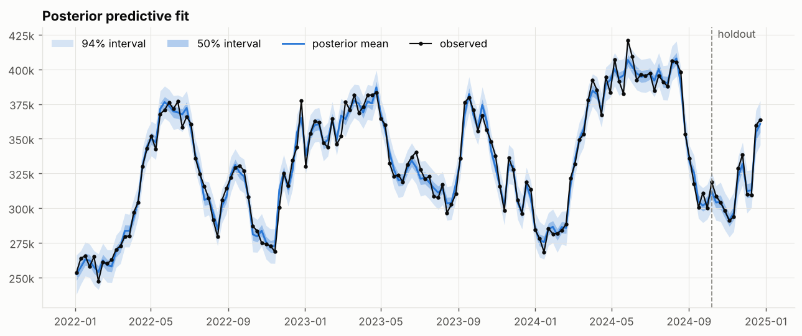
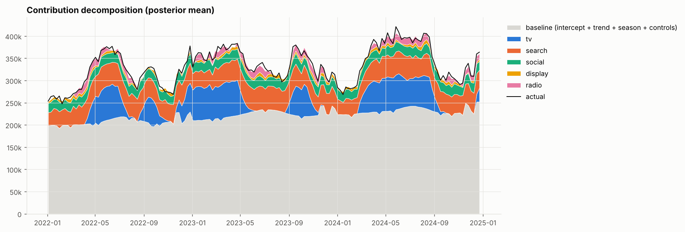
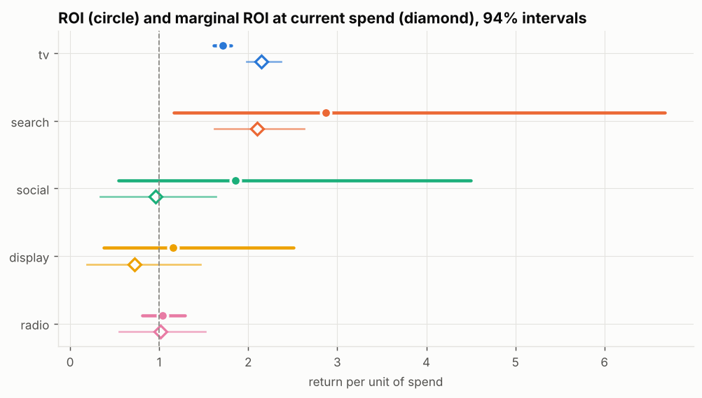
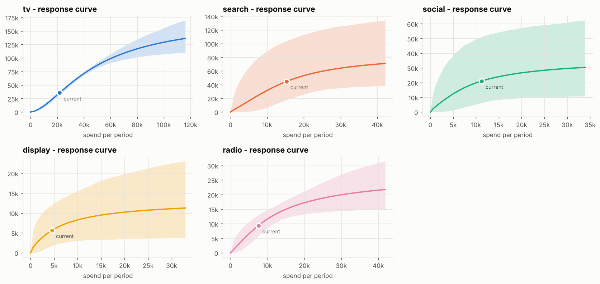
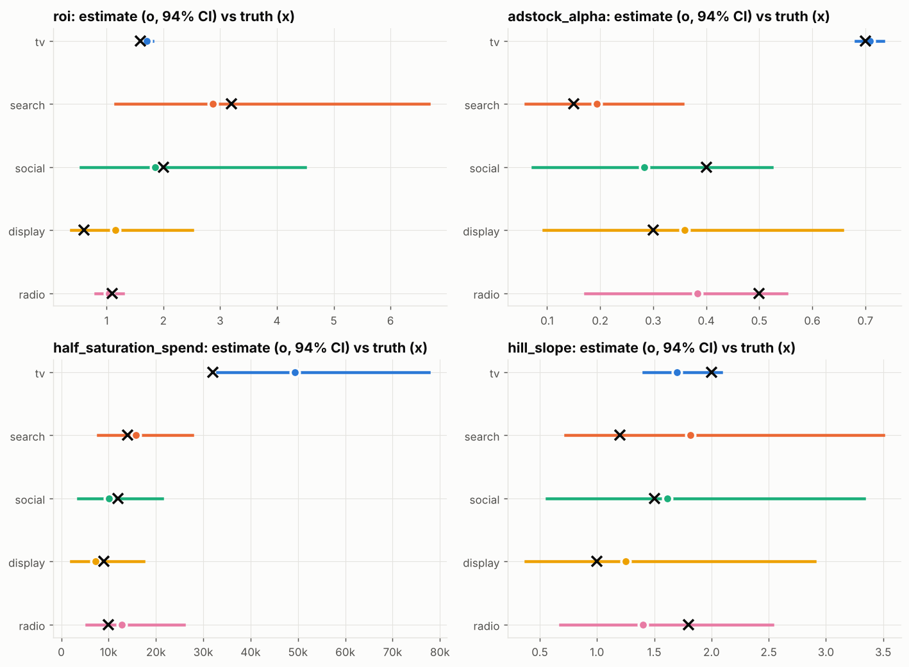

# Bayesian Marketing Mix Model (MMM)

An end-to-end, fully transparent **Bayesian Marketing Mix Model** built on [PyMC](https://www.pymc.io).
It takes a weekly table of sales and media spend and tells you:

* **How much each marketing channel actually drove**, with honest uncertainty (credible intervals).
* **ROI and *marginal* ROI** per channel, meaning the return on the next dollar.
* **How long each channel's effect lasts** (adstock / carry-over).
* **Where each channel saturates** (diminishing-returns response curves).
* **How to reallocate your budget** to get more outcome for the same spend, with the probability that the reallocation actually helps.

All of it is in one readable Python package of about 1,500 lines. There's no black box: every equation in the model is written out in [The model in detail](#the-model-in-detail).

---

## Table of contents

1. [What is an MMM, in plain English?](#1-what-is-an-mmm-in-plain-english)
2. [Features](#2-features)
3. [Repository layout](#3-repository-layout)
4. [Quick start (5 commands)](#4-quick-start-5-commands)
5. [Step-by-step guide](#5-step-by-step-guide)
   - [Step 1 - Install](#step-1---install)
   - [Step 2 - Understand the data format](#step-2---understand-the-data-format)
   - [Step 3 - Explore the example data](#step-3---explore-the-example-data)
   - [Step 4 - Configure the model](#step-4---configure-the-model)
   - [Step 5 - Run a quick smoke test](#step-5---run-a-quick-smoke-test)
   - [Step 6 - Run the full model](#step-6---run-the-full-model)
   - [Step 7 - Check the sampler converged](#step-7---check-the-sampler-converged)
   - [Step 8 - Check the model fits the data](#step-8---check-the-model-fits-the-data)
   - [Step 9 - Interpret the results](#step-9---interpret-the-results)
   - [Step 10 - Optimise the budget](#step-10---optimise-the-budget)
   - [Step 11 - Calibrate with experiments (lift tests)](#step-11---calibrate-with-experiments-lift-tests)
   - [Step 12 - Use your own data](#step-12---use-your-own-data)
   - [Step 13 - Iterate and compare models](#step-13---iterate-and-compare-models)
6. [The model in detail](#the-model-in-detail)
7. [Output reference](#output-reference)
8. [Using the Python API](#using-the-python-api)
9. [Troubleshooting](#troubleshooting)
10. [Assumptions and limitations](#assumptions-and-limitations)
11. [Testing and CI](#testing-and-ci)
12. [References](#references)

---

## 1. What is an MMM, in plain English?

Sales go up and down every week for many reasons at once: the season, a price change, a holiday, a competitor's promotion, and your marketing. A **Marketing Mix Model** is a regression on historical data that splits sales into those pieces so you can see how much of the total each marketing channel is responsible for.

Two features of advertising make it more than a plain regression:

| Effect | What it means | How the model handles it |
|---|---|---|
| **Carry-over (adstock)** | An ad seen this week still drives some sales next week and the week after. | Each channel's spend is spread over the following weeks with a learned decay. |
| **Diminishing returns (saturation)** | The first $10k on a channel works harder than the tenth $10k. | Adstocked spend is passed through a learned S-shaped or concave curve. |

**Why Bayesian?** Marketing data is short (a few years of weekly rows), noisy, and the channels are often correlated (TV and search tend to rise together). A Bayesian model:

* gives a **full probability distribution** for every quantity, not a single point estimate, so you know how sure to be ("search ROI is between 2.1 and 3.6 with 94% probability");
* lets you inject **prior knowledge** (industry benchmarks, earlier models) and **experimental results** (lift tests), which stabilises the estimates;
* propagates uncertainty all the way into budget recommendations.

---

## 2. Features

| Area | What is included |
|---|---|
| **Adstock** | Geometric, delayed (peaked, Google 2017) and Weibull-PDF (Robyn-style); normalised weights; configurable max lag |
| **Saturation** | Hill (S-shaped or concave), logistic, Michaelis-Menten |
| **Media priors** | **ROI priors** (LogNormal on ROI, Meridian-style, easy to elicit) or spend-share-scaled HalfNormal on coefficients |
| **Baseline** | Intercept, linear or **piecewise-linear trend with automatic changepoints** (Prophet-style, Laplace-regularised), yearly Fourier seasonality |
| **Controls** | Any number of non-media drivers (price, promotions, holidays, macro); binary columns auto-detected |
| **Likelihood** | Student-t (robust to outliers) or Normal |
| **Calibration** | **Lift-test / geo-experiment calibration** through an additional likelihood on the response curve |
| **Validation** | Prior predictive check, out-of-sample **holdout** evaluation, R-hat / ESS / divergences / E-BFMI checks, interval coverage, CRPS, residual autocorrelation |
| **Insights** | Full decomposition, ROI and marginal ROI with credible intervals, P(ROI > 1), carry-over length, response curves, prior-vs-posterior learning |
| **Optimisation** | Posterior-expected budget allocation with bounds, locked channels, uplift distribution and P(uplift > 0) |
| **Scenarios** | `mmm.forward(post, media=...)` re-runs the model on any what-if spend plan |
| **Validation of the method** | Synthetic data generator with **known ground truth** plus a parameter-recovery report |
| **Engineering** | Config-driven CLI, Markdown report, 16 charts, CSV tables, saved posterior, pytest suite (53 tests), GitHub Actions CI |

---

## 3. Repository layout

```
bayesian-mmm/
├── README.md                      <- you are here
├── pyproject.toml                 <- package metadata & dependencies
├── requirements.txt               <- same dependencies for plain `pip install -r`
├── Makefile                       <- shortcuts: make install / run / test
├── LICENSE
├── config/
│   └── config.yaml                <- EVERY modelling choice lives here
├── data/
│   ├── mmm_synthetic.csv          <- example dataset (156 weeks, 5 channels, 3 controls)
│   ├── lift_tests.csv             <- example experiment results for calibration
│   ├── ground_truth.json          <- true parameters used to simulate the data
│   └── true_contributions.csv     <- true weekly contribution of each channel
├── src/bayesian_mmm/
│   ├── config.py                  <- defaults + validation of config.yaml
│   ├── data.py                    <- loading, checks, train/holdout split, scaling, features
│   ├── transforms.py              <- adstock & saturation functions (numpy + PyTensor)
│   ├── model.py                   <- the PyMC model, fitting, numpy forward pass
│   ├── diagnostics.py             <- convergence + fit metrics
│   ├── analysis.py                <- decomposition, ROI, mROI, curves, recovery
│   ├── optimizer.py               <- budget optimisation
│   ├── plotting.py                <- all charts
│   ├── report.py                  <- Markdown report
│   ├── simulate.py                <- synthetic data with known truth
│   ├── pipeline.py                <- runs every step in order
│   └── cli.py                     <- `bayesian-mmm` command
├── examples/
│   └── python_api_example.py      <- what-if scenarios & custom optimisation in code
├── tests/                         <- pytest suite (fast unit tests + optional MCMC test)
└── .github/workflows/tests.yml    <- CI on every push / PR
```

---

## 4. Quick start (5 commands)

```bash
git clone https://github.com/<you>/bayesian-mmm.git && cd bayesian-mmm
python -m venv .venv && source .venv/bin/activate      # Windows: .venv\Scripts\activate
pip install -e ".[dev]"
bayesian-mmm run --config config/config.yaml           # ~5-15 minutes
open outputs/report.md                                 # or open it in VS Code / GitHub
```

### What the output looks like (example data)

Results from `bayesian-mmm run` on the bundled synthetic data. The full example report is in [`docs/example_run/report.md`](docs/example_run/report.md).

| | |
|---|---|
| Convergence | 0 divergences, max R-hat 1.003, min ESS > 1800 |
| Fit | R² 0.98 in-sample and 0.97 on the 12-week holdout; holdout MAPE 1.1% |
| Recovery | 18 of 20 true channel parameters inside the 94% credible intervals (≈ 94% expected) |







---

## 5. Step-by-step guide

### Step 1 - Install

**Prerequisites**

* Python **3.10 or newer** (`python --version`)
* `git`
* A C/C++ compiler. PyMC compiles parts of the model to C for speed:
  * macOS: `xcode-select --install`
  * Ubuntu/Debian: `sudo apt install build-essential`
  * Windows: the easiest route is installing with conda (below), which brings its own compiler.

**Option A: pip + virtual environment (recommended)**

```bash
git clone https://github.com/<you>/bayesian-mmm.git
cd bayesian-mmm
python -m venv .venv
source .venv/bin/activate          # Windows PowerShell: .venv\Scripts\Activate.ps1
pip install --upgrade pip
pip install -e ".[dev]"            # -e = editable: your code changes apply immediately
```

**Option B: conda (best on Windows)**

```bash
conda create -n mmm -c conda-forge python=3.12 pymc
conda activate mmm
pip install -e ".[dev]"
```

**Optional: faster samplers.** `pip install -e ".[fast]"` installs NumPyro and nutpie. Then set `sampler.nuts_sampler: numpyro` (or `nutpie`) in the config, which typically makes sampling 2-5x faster.

**Verify the install**

```bash
pytest -q                     # ~1-2 min, should print "51 passed, 2 skipped"
bayesian-mmm --help
```

---

### Step 2 - Understand the data format

The model needs **one CSV with one row per time period** (weekly is standard; daily also works). Example from `data/mmm_synthetic.csv`:

| date | revenue | tv | search | social | display | radio | price_index | competitor_promo | holiday |
|---|---|---|---|---|---|---|---|---|---|
| 2022-01-03 | 253479.51 | 0.0 | 11588.34 | 15304.93 | 4181.41 | 0.0 | 1.0523 | 0 | 0 |
| 2022-01-10 | 263784.73 | 0.0 | 9721.51 | 14654.02 | 5358.99 | 0.0 | 1.0319 | 0 | 0 |
| ... | | | | | | | | | |

| Column type | Rules |
|---|---|
| **Date** | Parseable dates, one row per period, no duplicates. Gaps are allowed but not recommended. |
| **Target** | The KPI you want to explain: revenue, units, sign-ups, and so on. Must be positive with no missing values. |
| **Channels** | **Spend per period**, ≥ 0, no missing values. For ROI to mean "revenue per $", spend and target must be in the same currency. Impressions or GRPs also work, but "ROI" then means "outcome per impression". |
| **Controls** | Anything else that moves the target: price, promotions, holidays, distribution, competitor activity, macro indices. 0/1 columns stay as they are; continuous columns are standardised automatically. |

**How much data do I need?** A rule of thumb is **at least 2 years of weekly data** (104+ rows) so yearly seasonality can be separated from media, and **about 10 observations per parameter**. Every channel needs real **variation** in spend: a channel with a constant budget every week cannot be measured by any MMM.

The loader (`data.validate_dataframe`) refuses data with missing columns, duplicates, missing values, negative spend, or a channel with zero spend throughout, and tells you exactly what is wrong.

---

### Step 3 - Explore the example data

The repository ships with a **synthetic** dataset generated by `src/bayesian_mmm/simulate.py`. Because we *know* the true carry-over, saturation and ROI of every channel, we can check that the model recovers them. Run this before trusting the model on real data.

| Channel | True adstock α | True half-saturation ($/wk) | True Hill slope | True ROI |
|---|---|---|---|---|
| tv | 0.70 (long memory) | 32 000 | 2.0 (S-shaped) | 1.6 |
| search | 0.15 (short memory) | 14 000 | 1.2 | 3.2 |
| social | 0.40 | 12 000 | 1.5 | 2.0 |
| display | 0.30 | 9 000 | 1.0 (concave) | 0.6 (loses money) |
| radio | 0.50 | 10 000 | 1.8 | 1.1 |

The data also has an upward trend that slows after week 100, yearly seasonality, a price effect, competitor promotions, holiday spikes, and Gaussian noise. TV and radio run in on/off **flights**, which is typical in practice.

Regenerate it (optionally with another seed or length):

```bash
bayesian-mmm simulate --out data --weeks 156 --seed 7
```

---

### Step 4 - Configure the model

**Every modelling decision is in `config/config.yaml`.** You only need to include keys you want to change; anything missing falls back to the defaults in `src/bayesian_mmm/config.py`. The options section by section:

#### `data`

| Key | Meaning |
|---|---|
| `path` | CSV file location |
| `date_col`, `target_col` | Column names for the date and the KPI |
| `channel_cols` | List of media spend columns |
| `control_cols` | List of non-media drivers (can be empty `[]`) |
| `holdout_periods` | The last N periods are hidden from the model and used to test it out-of-sample. 8-13 weeks is typical; use `0` to fit on everything once you are happy with the model. |
| `lift_tests_path` | Optional CSV of experiment results ([Step 11](#step-11---calibrate-with-experiments-lift-tests)); `null` to disable |
| `ground_truth_path` | Only for synthetic data; enables the parameter-recovery report |

#### `model.adstock`

| Key | Options | Guidance |
|---|---|---|
| `type` | `geometric` | Effect is strongest immediately and then decays. The default; works for most digital channels. |
| | `delayed` | Effect peaks after `theta` periods. Use it for TV, OOH, or anything with a build-up. |
| | `weibull` | Most flexible shape (Robyn). Needs more data. |
| `l_max` | integer | Maximum carry-over length in periods. 4-8 for weekly data; 8-13 if you suspect long TV effects. |
| `normalize` | `true` | Weights sum to 1, so adstock redistributes spend over time without inflating it. Keep this on. |

#### `model.saturation`

| `type` | Shape | When |
|---|---|---|
| `hill` | Can be S-shaped (slope > 1) or concave (slope ≤ 1) | Default, most flexible |
| `logistic` | Always concave | When you believe there is no threshold effect, or Hill is hard to identify |
| `michaelis_menten` | Concave, one parameter | Smallest data sets |

#### `model.trend`, `model.seasonality`, `model.likelihood`

| Key | Guidance |
|---|---|
| `trend.type` | `piecewise` (default) lets growth change speed at `n_changepoints` evenly spaced points. `linear` is a single slope. `none` is no trend. |
| `trend.changepoint_scale` (in priors) | Smaller values give a smoother trend. If the trend starts absorbing media effects (it wiggles in step with your campaigns), reduce it. |
| `seasonality.yearly_fourier_order` | Number of sine/cosine pairs. 2-4 is typical for weekly data; higher captures sharper seasonal shapes but risks overfitting. |
| `likelihood` | `studentt` (default) is robust to the odd outlier week; `normal` is the classic choice. |

#### `model.media_prior`: the most important modelling choice

* **`roi` (default).** You put a prior directly on each channel's ROI, for example "search probably returns 1-5x, median 2.5x". This is easy to discuss with the business and matches how Google's Meridian works. The default is `LogNormal(0, 0.8)`, a median ROI of 1.0 with a 94% prior range of about 0.2-4.5x. Set per-channel beliefs like this:

  ```yaml
  priors:
    channel_roi_mu:    {search: 2.5, display: 0.8}   # MEDIAN ROI you believe
    channel_roi_sigma: {search: 0.4}                 # smaller = more confident
  ```

* **`spend_share`.** A HalfNormal prior on the coefficient, scaled by each channel's share of spend: bigger channels are allowed bigger effects a priori. This is the PyMC-Marketing / LightweightMMM default.

#### `model.priors`

The full list with meanings is in [Priors](#priors). Prior pairs like `[2.0, 3.0]` are the `(alpha, beta)` of a Beta or Gamma distribution.

#### `sampler`

| Key | Guidance |
|---|---|
| `draws`, `tune` | Posterior samples kept and warm-up steps discarded. 1000 / 1500 is a solid default. |
| `chains` | Run at least 4 so convergence can be checked. |
| `target_accept` | 0.95 by default. Raise it to 0.98-0.99 if you see divergences (smaller steps, slower). |
| `nuts_sampler` | `pymc`, or `numpyro` / `nutpie` / `blackjax` for speed (needs the `[fast]` extra). |

#### `optimizer`

| Key | Guidance |
|---|---|
| `budget` | Total spend **per period** to allocate; `null` uses the current total. |
| `reference_periods` | "Current spend" is the average of the last N periods. 52 smooths out on/off flighting. |
| `lower/upper_bound_multiplier` | Each channel can move between 0.5x and 1.5x of current spend. This keeps recommendations within the range the model has observed; extrapolating far beyond historical spend is unreliable. |
| `horizon_periods` | Uplift is reported over this many periods. |

---

### Step 5 - Run a quick smoke test

Before a full run, check that everything works end to end with very few samples (about 1 minute):

```bash
bayesian-mmm run --config config/config.yaml --quick --output-dir outputs_quick
```

The results of a quick run are **not reliable**: the convergence checks will usually fail on purpose. It only confirms the data loads, the model builds and the outputs are written.

---

### Step 6 - Run the full model

```bash
bayesian-mmm run --config config/config.yaml
# or: make run
```

You will see the nine pipeline steps:

```
Step 1/9  Loading and validating data from data/mmm_synthetic.csv
          156 periods (144 train, 12 holdout), 5 channels, 3 controls
Step 2/9  Prior predictive check
Step 3/9  Sampling posterior with NUTS (4 chains x 1000 draws, 1500 tune)
Step 4/9  Convergence diagnostics
          R2 train=0.98  MAPE train=1.3%
          R2 holdout=0.96  MAPE holdout=1.1%
Step 5/9  Decomposing the outcome into components
Step 6/9  ROI, marginal ROI and carry-over per channel
Step 7/9  Adstock and response curves
Step 8/9  Optimising budget allocation
Step 9/9  Writing report
```

What each step does internally:

1. **Load & validate.** The CSV is read and checked. The last `holdout_periods` rows are set aside. Scalers are fitted **on training data only**: the target is divided by its max, each channel by its max, and continuous controls are z-scored.
2. **Prior predictive check.** The model simulates data from the priors alone, *before* seeing the target. If the simulated data is wildly off (negative revenue, 100x too large), the priors need adjusting.
3. **Sampling.** The No-U-Turn Sampler (NUTS) draws `chains × draws` samples from the posterior distribution of all parameters. This is the slow part.
4. **Diagnostics.** R-hat, effective sample size, divergences and E-BFMI are computed, along with in-sample and holdout accuracy.
5. **Decomposition.** Every week's outcome is split into intercept, trend, seasonality, each control, and each channel.
6. **Channel KPIs.** ROI, marginal ROI, P(ROI > 1), contribution share and mean carry-over lag, each with 94% credible intervals.
7. **Curves.** Adstock decay curves and steady-state response curves per channel.
8. **Budget optimisation.** Finds the per-period split that maximises expected contribution within the bounds.
9. **Report.** Writes `outputs/report.md`, the tables, the charts and the posterior (`trace.nc`).

**Runtime:** 5-15 minutes on a laptop for the example (156 weeks, 5 channels). It scales roughly linearly with weeks × channels.

---

### Step 7 - Check the sampler converged

> **Do not look at ROI numbers until this step passes.** A sampler that has not converged gives arbitrary answers.

Open `outputs/report.md` section 1, or `outputs/diagnostics.json`:

| Check | Target | What failure means |
|---|---|---|
| **Divergences** | 0 (a handful out of 4000 can be tolerated) | The sampler hit regions of the posterior it could not explore; estimates may be biased. |
| **R-hat** | ≤ 1.01 for every parameter | Chains disagree with each other, so they have not converged to the same distribution. |
| **ESS bulk / tail** | ≥ 400 | Too few *effective* independent samples for stable means and intervals. |
| **E-BFMI** | ≥ 0.3 | The sampler struggles to move through the posterior's energy levels. |

Also look at `plots/05_trace.png`. **Left:** each parameter's posterior should be a smooth single hump. **Right:** chain traces should look like "hairy caterpillars" with no trends and no chain stuck at a different level.

If anything fails, see [Troubleshooting](#troubleshooting).

---

### Step 8 - Check the model fits the data

**Accuracy** (report section 2, `diagnostics.json → fit_metrics`):

| Metric | Meaning | Rule of thumb |
|---|---|---|
| `r2` | Share of variance explained | Train > 0.8; holdout ideally close to train |
| `mape_pct` | Mean absolute % error | < 10% is good for weekly data |
| `nrmse` | RMSE / range of target | < 0.1 is good |
| `coverage_94_pct` | % of actual points inside the 94% predictive interval | **Close to 94.** Much lower means over-confidence; much higher means intervals are too wide. |
| `crps` | Continuous ranked probability score; rewards accurate *and* sharp distributions | Lower is better; use it to compare models |

**Holdout metrics are the honest ones.** The model never saw those weeks. A big gap between train and holdout means overfitting: simplify (fewer changepoints or Fourier terms, tighter priors).

**Charts to look at:**

* `04_posterior_predictive.png`: actual data should sit inside the shaded bands, including after the dashed holdout line.
* `05b_residuals.png`: residuals should look like random noise around zero. A strong pattern over time or large autocorrelation bars at low lags means something is missing (an event, a control, a sharper seasonality).
* `03_prior_predictive.png`: the prior bands should comfortably contain the data without being absurdly wide.

> **Good fit ≠ correct attribution.** A model can fit sales perfectly and still attribute them to the wrong channel when channels are correlated. Fit is necessary, not sufficient, which is why priors, lift tests and the recovery check matter.

---

### Step 9 - Interpret the results

#### 9.1 Decomposition (`06_decomposition.png`, `tables/decomposition.csv`)

A stacked area chart: the grey base is everything non-media (intercept, trend, seasonality, controls), with each channel's contribution on top. The black line is actual sales. `08_waterfall.png` shows the total for each component over the training window, and `07_baseline_components.png` shows trend, seasonality and each control separately.

#### 9.2 ROI vs marginal ROI (`09_roi.png`, `tables/channel_summary.csv`)

| Column | Meaning | How to use it |
|---|---|---|
| `roi` (`roi_lo`, `roi_hi`) | Total incremental outcome ÷ total spend over the training window, with 94% interval | "Did this channel pay back historically?" |
| `prob_roi_gt_1` | Posterior probability ROI > 1 | 0.95 means 95% confident it paid back |
| `marginal_roi` | Extra outcome from **one more unit** of spend at the current level | **This drives budget decisions.** A channel can have a high average ROI but a low marginal ROI if it is already saturated. |
| `mean_carryover_lag` | Average delay (periods) between spend and effect | Long lags mean a short-term test will under-measure the channel |
| `contribution_share_pct` vs `spend_share_pct` | Share of media effect vs share of spend | Channels whose effect share exceeds their spend share are candidates to grow (`10_share_comparison.png`) |

**Reading the forest plot:** circles are ROI and diamonds are marginal ROI; bars are 94% intervals; the dashed line is break-even (1.0). A wide bar means "the data can't tell precisely", which is a reason to run an experiment on that channel.

#### 9.3 Carry-over (`11_adstock.png`)

The share of a week's spend that takes effect in that week (lag 0) and each following week. TV typically spreads over many weeks; search acts almost immediately.

#### 9.4 Response curves (`12_response_curves.png`, `tables/response_curves.csv`)

Steady-state contribution per period at each spend level, with a 94% band. The dot is current spend.

* Dot on the **steep** part: room to grow.
* Dot on the **flat** part: saturated, so extra money is mostly wasted.
* An **S-shape** (slow start) means a minimum spend is needed before the channel works.

#### 9.5 Did the data actually teach us anything? (`14_prior_vs_posterior.png`, `tables/prior_vs_posterior.csv`)

Compare prior (grey) and posterior (colour) for each channel's ROI. The `shrinkage` column is 1 − posterior variance / prior variance:

* close to **1**: the data strongly informed the estimate;
* close to **0**: **the result is mostly your prior**. Report it as such and consider an experiment.

For ROI, shrinkage is computed on the log scale because the prior is LogNormal.

#### 9.6 Ground-truth recovery (synthetic data only) (`15_parameter_recovery.png`)

The true value (×) next to the estimate (o, 94% interval). On a correctly specified model, about 94% of the crosses should fall inside the bars.

---

### Step 10 - Optimise the budget

Report section 4, `tables/budget_allocation.csv` and `13_budget_allocation.png`.

**What it does.** It finds the per-period spend for each channel that maximises the **posterior-expected** total media contribution, subject to the total budget and the per-channel bounds. Because it averages over all posterior draws, a channel with an uncertain response curve is treated more cautiously than one the model is confident about.

| Output | Meaning |
|---|---|
| `current_spend` | Current mix (average of the last `reference_periods`), rescaled to the budget |
| `optimal_spend` / `change_pct` | Recommended spend and % change |
| `expected_uplift` (+ 94% interval) | Extra contribution over `horizon_periods` from reallocating |
| `prob_uplift_positive` | Probability the new mix beats the current one |

**Scenarios** (edit `config.yaml` → `optimizer`):

```yaml
optimizer:
  budget: 90000                # what if we had 90k per week instead?
  lower_bound_multiplier: 0.7  # be more conservative: max 30% cut...
  upper_bound_multiplier: 1.3  # ...and max 30% increase per channel
```

Locking channels (e.g. contractual TV) is done in Python; see [Using the Python API](#using-the-python-api).

**Treat it as a direction, not an order.** Move part of the way, measure, refit. The best next step is often a lift test on the channels the optimiser wants to change most.

---

### Step 11 - Calibrate with experiments (lift tests)

Observational data alone cannot always separate correlated channels. **Experiments can.** If you have run a geo-test, a conversion-lift study or a holdout test, add it to `data/lift_tests.csv`:

| channel | spend_before | spend_after | delta_y | delta_y_sd |
|---|---|---|---|---|
| search | 15000 | 20000 | 9663.84 | 1603.08 |
| tv | 30000 | 45000 | 32776.91 | 4281.60 |

Each row reads: "moving weekly spend on *channel* from `spend_before` to `spend_after` changed the weekly outcome by `delta_y`, with standard error `delta_y_sd`".

The model then adds this likelihood term:

$$\Delta y_i \sim \mathcal{N}\Big(\beta_c\,[\,\text{Sat}_c(x_{1,i}) - \text{Sat}_c(x_{0,i})\,],\ \sigma_i\Big)$$

This pulls that channel's response curve through the experimentally measured point. Even one or two tests on the most uncertain channels can tighten all ROI estimates, because channels compete to explain the same sales. To disable it, set `lift_tests_path: null`.

> Converting a test result: if the test reports a total lift over N weeks, divide by N to get a per-week value. Use the test's standard error (not its confidence-interval half-width) for `delta_y_sd`. The 95% CI half-width ÷ 1.96 is the standard error.

---

### Step 12 - Use your own data

A checklist:

1. **Aggregate** your data to one row per week (sum spend, sum sales).
2. **Put spend and sales in the same currency** if you want ROI in "$ per $".
3. **Add controls** for anything big that is not media: price changes, promotions, stock-outs, distribution, holidays, COVID periods, major PR events. Use 0/1 dummies for one-off events. Missing a big driver is the number one cause of wrong media attribution.
4. **Check spend variation:** a channel with nearly constant spend cannot be measured. Look at `01_data_overview.png`.
5. **Check correlations** (`02_spend_correlation.png`). Above about 0.7, the model will struggle to separate the two channels, so use ROI priors and lift tests, or combine the channels.
6. **Edit `config/config.yaml`:** `path`, column names, set `ground_truth_path: null`, and set `lift_tests_path` to your file or `null`.
7. **Set ROI priors** from benchmarks or previous studies (`channel_roi_mu`, `channel_roi_sigma`). Keep them wide if you don't know.
8. **Run** `--quick` first, then the full run.
9. **Go through Steps 7 → 8 → 9** in order. Don't skip convergence.
10. **Sense-check with the business:** do the ROIs and carry-over lengths make sense? Surprises are either insights or model problems, so investigate before acting.

---

### Step 13 - Iterate and compare models

MMM is iterative. Some common experiments:

| Question | Change |
|---|---|
| Is the effect delayed (TV, OOH)? | `adstock.type: delayed` |
| Is the carry-over longer than 8 weeks? | `l_max: 12` |
| Is the trend stealing media credit? | Lower `changepoint_scale`, fewer `n_changepoints`, or `trend.type: linear` |
| Overfitting (holdout ≪ train)? | Fewer Fourier terms and changepoints, tighter priors |
| Results depend heavily on priors? | Try `media_prior: spend_share` and compare; if conclusions flip, you need experiments |

Compare models on **holdout CRPS / MAPE / coverage** (lower CRPS and MAPE, coverage near 94) and on business plausibility. Point each run at its own `output.dir` (or use `--output-dir`) so results don't overwrite each other.

---

## The model in detail

### Scaling

Using training data only: $\tilde y_t = y_t / \max(y)$, $\tilde x_{t,c} = x_{t,c} / \max_t(x_{\cdot,c})$; continuous controls are standardised. This puts every parameter on a similar order of magnitude, so one set of default priors works for any business size, and it helps the sampler.

### Full model

$$
\begin{aligned}
\tilde y_t &\sim \text{StudentT}(\nu,\ \mu_t,\ \sigma) \\
\mu_t &= \underbrace{\alpha_0}_{\text{intercept}} + \underbrace{g(t)}_{\text{trend}} + \underbrace{s(t)}_{\text{seasonality}} + \underbrace{\textstyle\sum_k \gamma_k z_{t,k}}_{\text{controls}} + \underbrace{\textstyle\sum_c \beta_c\,\text{Sat}_c\big(\text{Adstock}_c(\tilde x_{\cdot,c})_t\big)}_{\text{media}}
\end{aligned}
$$

### Adstock (carry-over)

$$\text{Adstock}(x)_t = \sum_{l=0}^{L-1} w_l\, x_{t-l}, \qquad \sum_l w_l = 1$$

| Type | Weights before normalising | Parameters |
|---|---|---|
| Geometric | $w_l = \alpha^l$ | $\alpha \in (0,1)$, the carry-over rate |
| Delayed | $w_l = \alpha^{(l-\theta)^2}$ | $\alpha$, plus $\theta$ = peak lag |
| Weibull PDF | $w_l = \tfrac{k}{\lambda}\big(\tfrac{l+1}{\lambda}\big)^{k-1} e^{-((l+1)/\lambda)^k}$ | shape $k$, scale $\lambda$ |

**Implementation:** a lag tensor `X_lag[l, t, c] = x[t-l, c]` is pre-computed once, so adstock inside the model is a single weighted sum. That is fast and fully differentiable for NUTS.

### Saturation (diminishing returns)

| Type | Formula | Parameters |
|---|---|---|
| Hill | $\dfrac{x^S}{x^S + K^S}$ | $K$ = half-saturation point; $S$ = slope (S > 1 gives an S-curve) |
| Logistic | $\dfrac{1 - e^{-\lambda x}}{1 + e^{-\lambda x}}$ | $\lambda$ |
| Michaelis-Menten | $\dfrac{x}{x + K}$ | $K$ |

Adstock is applied **before** saturation: the "pool" of advertising is built up first, and diminishing returns act on the pool.

### ROI parameterisation

With `media_prior: roi`, ROI is the sampled parameter and the coefficient is derived:

$$\text{ROI}_c \sim \text{LogNormal}(\mu_c, \sigma_c), \qquad \beta_c = \frac{\text{ROI}_c \cdot \sum_t x_{t,c}}{\max(y)\cdot \sum_t \text{Sat}_c(\text{Adstock}_c(\tilde x_c))_t}$$

By construction, the model's total contribution ÷ total spend over the training window equals $\text{ROI}_c$ exactly (verified in `tests/test_model.py`).

### Trend

$$g(t) = k\,t + \sum_j \delta_j\,(t - s_j)_+, \qquad \delta_j \sim \text{Laplace}(0, \tau)$$

Changepoints $s_j$ are spread evenly over the first `changepoint_range` of the training period. The sparse Laplace prior keeps most $\delta_j$ near 0, so the trend bends only where the data insists. In the holdout and forecasts, the trend extends with its last slope.

### Seasonality

$$s(t) = \sum_{n=1}^{N} \big[a_n \sin(2\pi n\, d_t / P) + b_n \cos(2\pi n\, d_t / P)\big]$$

where $d_t$ is days since a fixed epoch and $P = 365.25$. Because the terms are based on calendar date, they extend naturally into the holdout.

### Priors

All priors are on the **scaled** problem (target ÷ its max).

| Parameter | Prior | Rationale |
|---|---|---|
| Intercept $\alpha_0$ | Normal(0.5, 0.3) | Baseline is usually 30-70% of peak sales |
| Trend slope $k$ | Normal(0, 0.3) | At most ±~60% change over the training window |
| Changepoint $\delta_j$ | Laplace(0, 0.05) | Sparse slope changes |
| Fourier $a_n, b_n$ | Normal(0, 0.2) | Seasonal swings up to ~±40% of peak |
| Controls $\gamma_k$ | Normal(0, 0.2) | Effect of a 1-sd change (or of the event, for 0/1 controls) |
| Adstock $\alpha_c$ | Beta(2, 3) | Mean 0.4, all of (0, 1) possible |
| Delayed $\theta_c$ | Gamma(2, 1) | Peak around 1-3 periods |
| Weibull shape / scale | Gamma(2, 2) / Gamma(2, 4) | |
| Half-saturation $K_c$ | Gamma(3, 6) | Mean 0.5 × max historical spend; allows > 1 (not yet saturated) |
| Hill slope $S_c$ | Gamma(3, 2) | Mean 1.5; covers concave and S-shaped |
| Logistic $\lambda_c$ | Gamma(3, 1) | |
| ROI$_c$ (`roi`) | LogNormal(0, 0.8) | Median 1.0, 94% range ≈ 0.2-4.5 |
| $\beta_c$ (`spend_share`) | HalfNormal(2 · share$_c$ · C/2) | Bigger budgets are allowed bigger effects |
| Noise $\sigma$ | HalfNormal(0.1) | |
| Student-t $\nu$ | Gamma(2, 0.1) | Mean 20; small $\nu$ means heavy tails |

### Derived quantities

* **Contribution** of channel $c$ in week $t$ (original units): $\max(y)\cdot\beta_c\,\text{Sat}_c(\text{Adstock}_c(\tilde x_c))_t$
* **ROI:** $\sum_t \text{contribution}_{t,c} / \sum_t x_{t,c}$ over the training window
* **Steady-state response:** with normalised adstock, constant spend $s$ forever gives adstocked level $s$, so response $= \max(y)\,\beta_c\,\text{Sat}_c(s / \max x_c)$
* **Marginal ROI:** $[\text{resp}(1.01\,s) - \text{resp}(s)] / (0.01\,s)$ at reference spend $s$
* **Mean carry-over lag:** $\sum_l l\, w_l$

Every derived quantity is computed **per posterior draw**, so each one has a full distribution and an interval. All intervals are 94% equal-tailed (3rd to 97th percentile), following the ArviZ convention.

### Two implementations, one model

The model exists twice: as a PyMC graph for sampling (`BayesianMMM.build`) and as a numpy function (`BayesianMMM.forward`) for analysis, holdout prediction and what-if scenarios. A test checks they agree to numerical precision, so every chart reflects exactly the model that was fit.

---

## Output reference

Everything is written to `outputs/` (configurable).

| File | Content |
|---|---|
| `report.md` | Human-readable summary with key tables and charts |
| `diagnostics.json` | Convergence checks, fit metrics, prior check, optimiser summary |
| `config_used.yaml` | Exact configuration of this run (for reproducibility) |
| `trace.nc` | Full posterior + posterior predictive; reload with `arviz.from_netcdf("outputs/trace.nc")` |
| **tables/** | |
| `data_summary.csv` | Spend totals, shares, % of weeks active |
| `parameter_summary.csv` | Mean, sd, interval, ESS, R-hat for every parameter |
| `decomposition.csv` | Weekly contribution of every component (+ actual, fitted, holdout flag) |
| `contribution_shares.csv` | Total contribution per component over the training window |
| `channel_summary.csv` | ROI, marginal ROI, P(ROI > 1), contribution, carry-over, half-saturation |
| `prior_vs_posterior.csv` | Prior and posterior mean/sd of ROI, with shrinkage |
| `adstock_curves.csv`, `response_curves.csv` | Curve data with intervals, for your own charts |
| `budget_allocation.csv` | Current vs optimal spend and contribution |
| `parameter_recovery.csv` | Truth vs estimate (synthetic data only) |
| **plots/** | |
| `01_data_overview.png` | Target and spend over time (holdout shaded) |
| `02_spend_correlation.png` | Channel spend correlation matrix |
| `03_prior_predictive.png` | Prior predictive check |
| `04_posterior_predictive.png` | Fit with 50% / 94% bands, holdout marked |
| `05_trace.png` | MCMC trace plot |
| `05b_residuals.png` | Residuals over time, distribution, autocorrelation |
| `06_decomposition.png` | Stacked contribution chart |
| `07_baseline_components.png` | Trend, seasonality and controls |
| `08_waterfall.png` | Contribution waterfall |
| `09_roi.png` | ROI and marginal ROI forest plot |
| `10_share_comparison.png` | Spend share vs contribution share |
| `11_adstock.png` | Adstock weights per channel |
| `12_response_curves.png` | Response curves with current spend marked |
| `13_budget_allocation.png` | Current vs optimised budget |
| `14_prior_vs_posterior.png` | What the data taught us |
| `15_parameter_recovery.png` | Truth vs estimate (synthetic data only) |

---

## Using the Python API

See `examples/python_api_example.py` for a runnable version.

```python
from bayesian_mmm import analysis, diagnostics, optimize_budget
from bayesian_mmm.config import load_config
from bayesian_mmm.pipeline import build_model

cfg = load_config("config/config.yaml")           # optionally pass overrides as a dict
mmm = build_model(cfg)                            # load + validate + build PyMC model
mmm.sample_prior_predictive()
mmm.fit()

print(diagnostics.convergence_report(mmm)["checks"])
summary = analysis.channel_summary(mmm, reference_periods=52)

# What-if: +20% TV over the last 13 weeks (carry-over within the data window is handled automatically)
post = mmm.posterior(max_draws=1000)
media = mmm.data.media.copy()
media[-13:, mmm.data.channels.index("tv")] *= 1.2
delta = mmm.forward(post, media=media)["mu"] - mmm.forward(post)["mu"]   # (draws, periods); effects after the last date are cut off

# Optimise a bigger budget while locking radio
alloc, s = optimize_budget(mmm, budget=100_000, reference_periods=52,
                           fixed_channels={"radio": 7_000})

# Reload a saved posterior for later analysis
import arviz as az
idata = az.from_netcdf("outputs/trace.nc")
```

Useful objects:

* `mmm.data`: an `MMMData` with raw arrays, scalers and feature builders
* `mmm.model`: the PyMC model (e.g. `pm.model_to_graphviz(mmm.model)` draws the graph if graphviz is installed)
* `mmm.idata`: the posterior (ArviZ InferenceData / xarray DataTree)
* `mmm.posterior()`: a dict of numpy arrays, one row per draw
* `mmm.forward(params, media=..., controls=...)`: every component, in original units
* `mmm.steady_state_response(params, spend)`: response-curve values

---

## Troubleshooting

| Symptom | Likely cause | Fix |
|---|---|---|
| **Divergences** | Posterior has tight, curved regions (often saturation parameters) | Raise `target_accept` to 0.98-0.99; tighten priors on `sat_half` / `sat_slope`; try `saturation.type: logistic`; reduce `l_max` |
| **R-hat > 1.01 / low ESS** | Chains haven't mixed, or the posterior is multimodal | More `tune` and `draws`; check the trace plot for a stuck chain; tighter priors; remove highly collinear channels |
| **Sampling very slow** | Long series, many channels, high `l_max` | `nuts_sampler: numpyro` or `nutpie`; reduce `l_max`; aggregate small channels |
| **Holdout much worse than train** | Overfitting, or something changed in the holdout period | Fewer changepoints and Fourier terms; add missing controls; check for a structural break |
| **Implausible ROI (e.g. 50x)** | Missing control, spend correlated with seasonality, or channel too small to measure | Add controls; set informative ROI priors; run a lift test; merge tiny channels |
| **ROI ≈ prior** (shrinkage ≈ 0) | Not enough variation in that channel's spend | Be explicit that the estimate is prior-driven; run an experiment; vary spend deliberately |
| **Trend wiggles with campaigns** | Trend is absorbing media effects | Lower `changepoint_scale`, fewer changepoints, or `trend.type: linear` |
| **Residuals show yearly pattern** | Seasonality too smooth | Increase `yearly_fourier_order`, or add holiday dummies as controls |
| `Could not save trace` | No netCDF backend | `pip install h5netcdf` |
| Compiler errors on install | No C compiler | See [Step 1](#step-1---install), or install via conda |
| `Budget ... is infeasible` | Budget outside the sum of the bounds | Change `budget` or the bound multipliers |

---

## Assumptions and limitations

Be explicit about these when presenting results:

* **Correlation is not causation.** An MMM estimates causal effects only if all major drivers are in the model. Unmodelled drivers that move with spend (e.g. you spend more when demand is high) bias ROI **upwards**. Experiments are the gold standard; use them to calibrate.
* **Additive structure.** Channels don't interact (no TV × search synergy), and media effects don't scale with the baseline. A multiplicative / log-log variant is a natural extension.
* **Static effects.** ROI and saturation are constant over the training window. For long histories, consider refitting on rolling windows.
* **Steady-state curves.** Response curves and the optimiser assume constant weekly spend. For S-shaped channels run in bursts (TV flighting), real campaigns can do better than steady state, so treat TV recommendations as conservative.
* **Extrapolation.** Saturation beyond the highest observed spend is a prior-driven guess, which is why the optimiser is bounded.
* **Upper funnel and long-term brand effects** beyond `l_max` are not captured.
* **National-level model.** Geo-level (hierarchical) data would greatly improve identification; the code structure (channel dims) extends naturally to a geo dimension.

---

## Testing and CI

```bash
pytest -q              # 51 fast tests: transforms, data, config, every model variant, numpy-vs-PyMC equivalence
pytest -q --runslow    # + a short MCMC fit exercising the full analysis & optimiser
```

GitHub Actions (`.github/workflows/tests.yml`) runs both on Python 3.11 and 3.12 for every push and pull request.

Highlights:

* every adstock × saturation × media-prior combination builds with a finite log-probability;
* the numpy forward pass reproduces the PyMC graph exactly;
* the ROI parameterisation is exact (contribution ÷ spend = ROI);
* the Hill gradient is finite at zero spend (a classic source of sampler failure);
* decomposition components add up to the fitted values;
* the optimiser respects the budget and bounds and never does worse than the current mix.

---

## References

* Jin, Y., Wang, Y., Sun, Y., Chan, D., & Koehler, J. (2017). *Bayesian Methods for Media Mix Modeling with Carryover and Shape Effects.* Google Inc.
* Chan, D., & Perry, M. (2017). *Challenges and Opportunities in Media Mix Modeling.* Google Inc.
* Google Meridian: ROI priors and calibration, https://github.com/google/meridian
* PyMC-Marketing: https://github.com/pymc-labs/pymc-marketing
* Meta Robyn: Weibull adstock, https://github.com/facebookexperimental/Robyn
* Taylor, S. J., & Letham, B. (2018). *Forecasting at Scale (Prophet).* Piecewise trend with changepoints.
* Vehtari, A., Gelman, A., Simpson, D., Carpenter, B., & Bürkner, P.-C. (2021). *Rank-normalization, folding, and localization: An improved R-hat.* Bayesian Analysis.
* Betancourt, M. (2017). *A Conceptual Introduction to Hamiltonian Monte Carlo.*

---

## License

MIT; see `LICENSE`.
