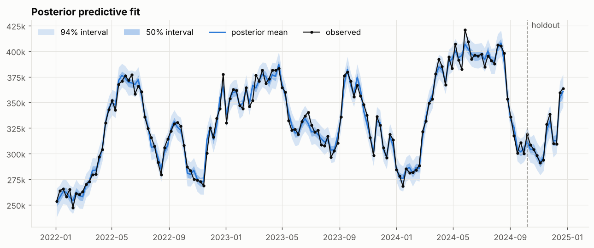
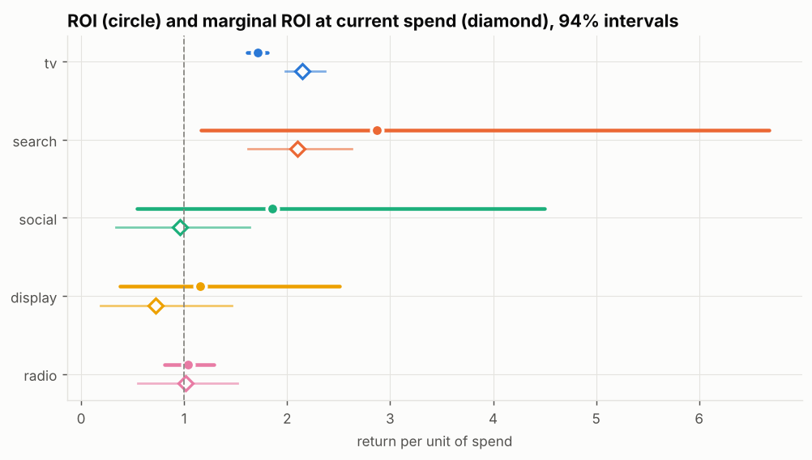
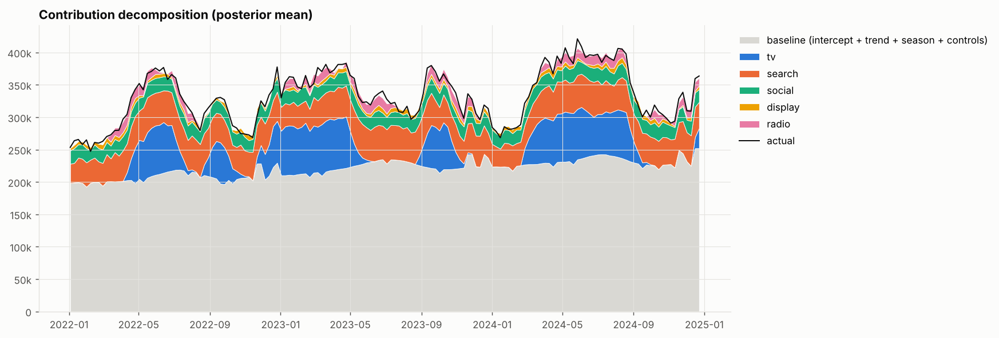
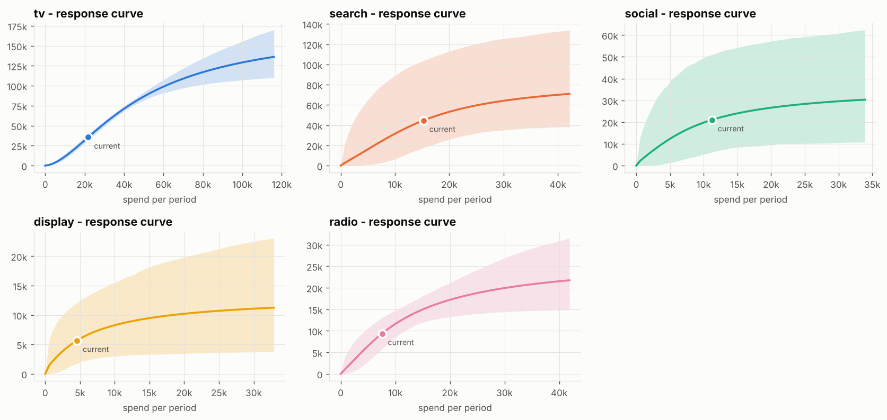
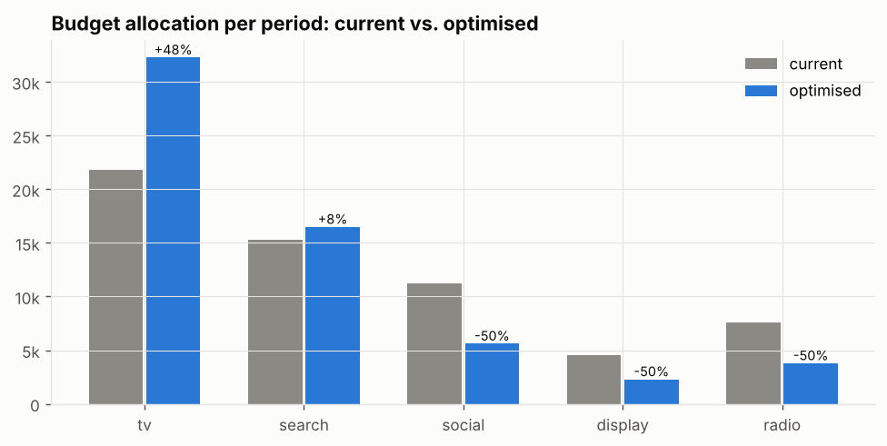
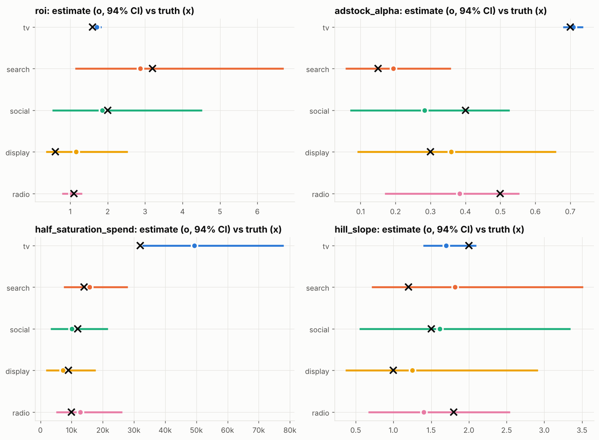

# Bayesian Marketing Mix Model - Results Report

*Generated 2026-11-19 14:09*

## 1. Sampler convergence: PASSED

| check | value | threshold | ok |
|---|---|---|---|
| divergences | 0 | 0 | True |
| max R-hat | 1.003 (trend_delta[1]) | <= 1.01 | True |
| min ESS (bulk / tail) | 2150 / 1839 | >= 400 | True |
| min E-BFMI | 0.82 | >= 0.3 | True |

If any check fails, see *Troubleshooting* in the README before trusting the numbers below.

## 2. Model fit

|  | r2 | mape_pct | nrmse | rmse | coverage_94_pct | coverage_50_pct | crps |
|---|---|---|---|---|---|---|---|
| train | 0.984 | 1.292 | 0.031 | 5,381.074 | 95.833 | 55.556 | 3,074.984 |
| holdout | 0.968 | 1.091 | 0.057 | 4,178.386 | 100.000 | 66.667 | 2,654.669 |

* `coverage_94_pct` should be close to 94 - lower means the model is over-confident.
* Holdout metrics are true out-of-sample performance (the model never saw these periods).

## 3. Channel performance (training window)

| channel | spend | contribution | roi | roi_lo | roi_hi | prob_roi_gt_1 | marginal_roi | mean_carryover_lag | spend_share_pct | contribution_share_pct |
|---|---|---|---|---|---|---|---|---|---|---|
| tv | 3,057,488.30 | 5,233,259.79 | 1.71 | 1.61 | 1.81 | 1.00 | 2.15 | 1.89 | 35.65 | 33.20 |
| search | 2,229,808.12 | 6,406,224.14 | 2.87 | 1.16 | 6.68 | 0.98 | 2.10 | 0.25 | 26.00 | 37.34 |
| social | 1,619,228.82 | 3,004,798.07 | 1.86 | 0.54 | 4.50 | 0.79 | 0.96 | 0.43 | 18.88 | 18.05 |
| display | 668,357.10 | 773,020.42 | 1.16 | 0.38 | 2.51 | 0.52 | 0.72 | 0.63 | 7.79 | 4.82 |
| radio | 1,001,198.15 | 1,039,452.83 | 1.04 | 0.81 | 1.29 | 0.60 | 1.01 | 0.64 | 11.67 | 6.58 |

* **roi** = incremental outcome per unit spend over the training window (94% interval in `roi_lo`/`roi_hi`).
* **marginal_roi** = return on the *next* unit of spend at the current spend level - the number that matters for reallocating budget.
* **prob_roi_gt_1** = posterior probability the channel pays back.

## 4. Budget optimisation

Budget per period: **60,443**, horizon 13 periods.

Expected uplift from reallocating: **131,030** (+8.7%), 94% interval [39,123, 199,873], P(uplift > 0) = 0.99.

| channel | current_spend | optimal_spend | change_pct | current_contribution | optimal_contribution |
|---|---|---|---|---|---|
| tv | 21,831.77 | 32,276.46 | 47.84 | 35,594.10 | 57,175.84 |
| search | 15,253.26 | 16,487.31 | 8.09 | 44,676.88 | 47,175.40 |
| social | 11,220.06 | 5,610.03 | -50.00 | 21,031.61 | 13,461.19 |
| display | 4,575.16 | 2,287.58 | -50.00 | 5,676.28 | 3,625.87 |
| radio | 7,562.26 | 3,781.13 | -50.00 | 9,359.78 | 4,979.60 |

## 5. Ground-truth recovery (synthetic data)

90% of true parameters fall inside the 94% credible interval.

| channel | parameter | true | estimate | lo | hi | covered_by_94_ci |
|---|---|---|---|---|---|---|
| tv | roi | 1.600 | 1.712 | 1.615 | 1.807 | False |
| tv | adstock_alpha | 0.700 | 0.709 | 0.682 | 0.734 | True |
| tv | half_saturation_spend | 32,000.000 | 49,332.456 | 33,015.192 | 77,653.806 | False |
| tv | hill_slope | 2.000 | 1.698 | 1.404 | 2.083 | True |
| search | roi | 3.200 | 2.873 | 1.160 | 6.676 | True |
| search | adstock_alpha | 0.150 | 0.193 | 0.060 | 0.356 | True |
| search | half_saturation_spend | 14,000.000 | 15,732.623 | 7,799.562 | 27,647.265 | True |
| search | hill_slope | 1.200 | 1.818 | 0.723 | 3.502 | True |
| social | roi | 2.000 | 1.856 | 0.544 | 4.502 | True |
| social | adstock_alpha | 0.400 | 0.284 | 0.073 | 0.524 | True |
| social | half_saturation_spend | 12,000.000 | 10,045.489 | 3,634.683 | 21,365.592 | True |
| social | hill_slope | 1.500 | 1.617 | 0.563 | 3.331 | True |
| display | roi | 0.600 | 1.157 | 0.376 | 2.509 | True |
| display | adstock_alpha | 0.300 | 0.360 | 0.093 | 0.656 | True |
| display | half_saturation_spend | 9,000.000 | 7,291.249 | 2,085.794 | 17,373.277 | True |
| display | hill_slope | 1.000 | 1.253 | 0.377 | 2.901 | True |
| radio | roi | 1.100 | 1.038 | 0.809 | 1.288 | True |
| radio | adstock_alpha | 0.500 | 0.384 | 0.172 | 0.552 | True |
| radio | half_saturation_spend | 10,000.000 | 12,727.167 | 5,377.890 | 25,863.003 | True |
| radio | hill_slope | 1.800 | 1.401 | 0.678 | 2.533 | True |

## Files

* `tables/` - every number in this report as CSV
* `plots/` - all charts
* `diagnostics.json` - convergence + fit metrics
* `trace.nc` - full posterior (open with `arviz.from_netcdf`)